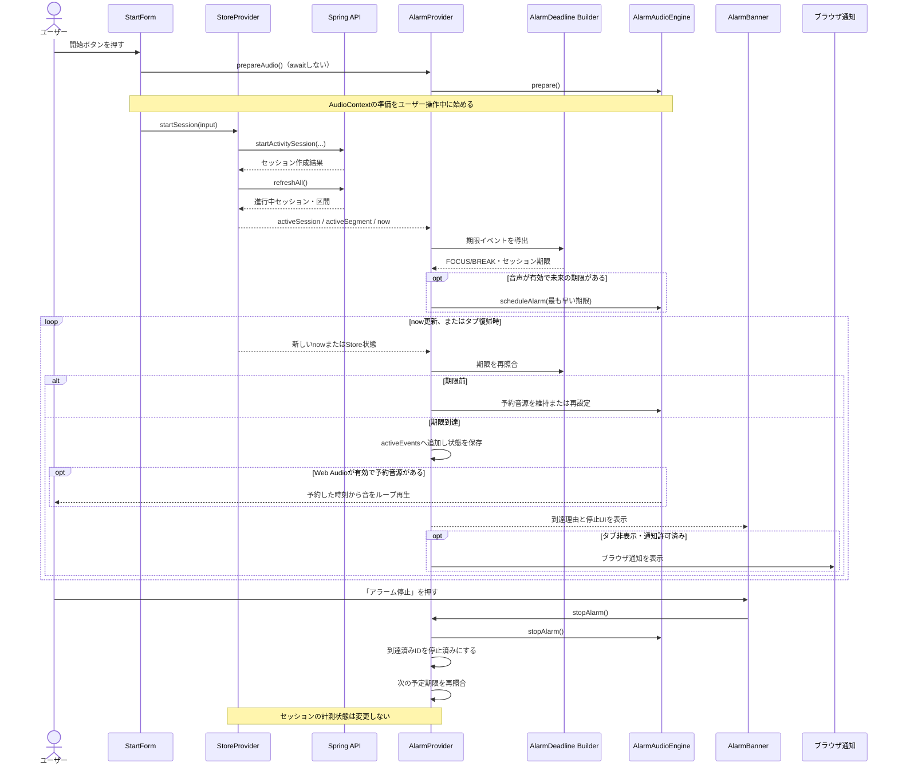

# 09. アラーム機能

この資料では、Time Trackerのアラームがどこで予定時間を判定し、どのように音を予約・再生し、どう停止するかを現行コードに沿って追う。コードを読むときは、まず[`app/page.tsx`](../../frontend/nextjs/app/page.tsx)からProviderの配置を確認し、次に[`lib/alarm-context.tsx`](../../frontend/nextjs/lib/alarm-context.tsx)の`AlarmProvider`、[`lib/alarm-events.ts`](../../frontend/nextjs/lib/alarm-events.ts)の期限計算、[`lib/alarm-audio.ts`](../../frontend/nextjs/lib/alarm-audio.ts)の音声処理へ進むと流れを掴みやすい。

画面からAPI、Storeへ進む通常のセッション操作は[主要処理フロー](./02_主要処理フロー.md)、Providerや画面全体の構造は[Frontend解説](./03_フロントエンド解説.md)、重要ファイルの一覧は[重要ファイル一覧](./07_重要ファイル一覧.md)を参照。

## 1. 概要と要求仕様

予定時間は、セッションやFOCUS/BREAK区間を自動終了させる時刻ではない。予定に達したことを知らせ、その後もユーザーが停止操作をするまでアラームを鳴らすための基準である。アラームを止めても、Storeのセッションや区間は終了せず、計測は続く。

現行実装の振る舞いは次の通り。

| 項目 | 現行仕様 |
| --- | --- |
| 対象の予定 | 進行中FOCUS区間、BREAK区間、セッション全体 |
| 到達時の音 | Web Audio APIで合成した電子音をループ再生。音声が未有効・再生不可の場合は、音声の再有効化を案内する |
| 画面表示 | 全画面共通の`AlarmBanner`に理由と「アラーム停止」ボタンを表示 |
| OS通知 | タブが非表示で、Notification APIが利用可能かつ許可済みの場合に補助表示 |
| アラームToast | 表示しない。通常の操作成功・エラーToastは既存の`Toaster`経由で表示する |
| 停止 | アプリ内の「アラーム停止」ボタン。計測終了の操作とは別 |
| 同じ期限への再発火 | 停止済みイベントIDを保持し、同じ期限では再発火しない |
| 予定変更 | 変更前から鳴動中のイベントは維持。延長後の期限は別イベントとして扱う |
| セッション終了 | Storeで終了が確認されると、予約音源と保存されたアラーム状態を破棄 |

## 2. 関連ファイルと責務

| ファイル | 責務と主な呼び出し |
| --- | --- |
| `frontend/nextjs/app/page.tsx` | `StoreProvider`、`AlarmProvider`、全画面共通の`AlarmBanner`を配置する |
| `frontend/nextjs/lib/store.tsx` | `StoreProvider`。認証、APIデータ、進行中セッション・区間、1秒ごとの`now`を管理する。`startSession()`や`endSession()`の成功後は`refreshAll()`でサーバー状態を読み直す |
| `frontend/nextjs/lib/alarm-context.tsx` | `AlarmProvider`と`useAlarm()`。Storeの状態から期限を照合し、アラームイベント、停止済みID、音声準備状態、音量、OS通知を管理する |
| `frontend/nextjs/lib/alarm-events.ts` | `deriveAlarmDeadlines()`と`AlarmDeadline`型。Storeのセッション・区間をアラーム期限イベントへ変換する |
| `frontend/nextjs/lib/alarm-audio.ts` | `AlarmAudioEngine`。`AudioContext`、音源ノード、音量、ループ再生、テスト音、停止、リソース解放を扱う。イベントIDは保持しない |
| `frontend/nextjs/components/start-form.tsx` | `handleStart()`で入力を検証し、API開始処理の前にユーザー操作中の`prepareAudio()`を呼び、その後`startSession()`を呼ぶ |
| `frontend/nextjs/components/alarm-banner.tsx` | 鳴動理由、停止ボタン、音声再有効化ボタンを表示する |
| `frontend/nextjs/components/alarm-settings-dialog.tsx` | 音量スライダー、テスト音、OS通知の状態表示と許可要求を提供する |
| `frontend/nextjs/components/app-shell.tsx` | ヘッダーからアラーム設定Dialogを開く。ログアウト成功時は`clearForLogout()`を呼ぶ |
| `frontend/nextjs/components/active-session.tsx` | 区間切り替え、予定延長、セッション終了をStoreへ依頼する。アラーム停止は扱わない |
| `frontend/nextjs/app/layout.tsx` | Sonnerの`Toaster`を全体に配置する。アラーム到達Toastは呼ばれないが、通常Toastの表示には使われる |

## 3. 開始から発火・停止まで



`StartForm.handleStart()`は`void prepareAudio()`を呼ぶため、音声準備とセッション開始APIは待ち合わせずに進む。音声準備が後から完了した場合も`prepareAudio()`が`reconcile()`を呼び直すので、その時点で期限の予約に進める。`AlarmAudioEngine`は将来の音声開始時刻をWeb Audioの時計に予約する一方、Reactの`activeEvents`やOS通知は`AlarmProvider.reconcile()`が期限を照合したときに更新する。音声の開始時刻と画面stateの反映は別の仕組みで同期している。詳しくは「6. Web Audio」を参照。

### 区間切り替え・予定変更・セッション終了

- **FOCUS/BREAK切り替え:** `ActiveSession.handleSwitch()` → `useStore().switchSegment()` → `StoreProvider`のAPI mutationと`refreshAll()` → 新しい`activeSegment`を受けて`AlarmProvider.reconcile()`の順に進む。鳴動中イベントは残り、未到達の古い区間予約は取り消される。新しい区間に予定があれば別イベントIDで予約する。
- **予定延長:** `ActiveSession`から`extendActiveSegment()`または`extendActiveSession()`を呼ぶ。StoreがAPI更新後に`refreshAll()`し、AlarmProviderは変更後の期限を再導出する。延長前のアラームがすでに鳴っていればそのまま鳴り、延長後の期限も新しいイベントとして待機する。
- **セッション終了:** 確認Dialogの「終了する」から`endSession()` → `finishActivitySession()` → `refreshAll()`と進む。取得成功後にStoreの`activeSession`がなくなると、次の`reconcile()`が音を止め、`AudioContext`を閉じて保存状態を消す。APIや再取得に失敗してStoreに以前のセッションが残る場合は、終了とみなさない。

## 4. `StoreProvider`と`AlarmProvider`の役割

この2つは親子のProviderだが、同じ状態を二重に管理するものではない。

| 管理主体 | 管理するもの | 管理しないもの |
| --- | --- | --- |
| `StoreProvider` (`lib/store.tsx`) | サーバー由来のセッション・区間、認証、`activeSession`、`activeSegment`、現在時刻`now`、データ取得状態 | 音源ノード、アラームの停止済みID |
| `AlarmProvider` (`lib/alarm-context.tsx`) | Storeから導出した期限イベント、鳴動中イベント、停止済みID、次に予約したイベントID、音声の準備状態、音量、通知許可状態 | セッションや区間の業務データの更新 |
| `AlarmAudioEngine` (`lib/alarm-audio.ts`) | AudioContextと音源・GainNodeなどブラウザの音声リソース | 予定時刻の業務イベント、セッションID、停止済みイベントID |

`StoreProvider`はアラームを知らず、これまで通りAPIからタイマー状態を取得・更新する。`AlarmProvider`は`useStore()`でその状態を読むが、アラームを止めてもStoreの操作関数は呼ばない。音源エンジンは物理的な音声再生だけを担当する。イベントと音源の対応は`AlarmRuntime.scheduledEventId`として`AlarmProvider`側に置く。

`dataReady`は、全アプリデータを一度でも正常に取得したことを示す。`AlarmProvider.reconcile()`は`dataReady`がfalseなら待機し、初期値の`activeSession === null`をセッション終了と解釈しない。初回取得後の再取得失敗ではStoreが以前の`sessions`を保持するので、通信エラーで鳴動中のアラームを終了扱いしない。

## 5. 期限イベントと重複発火防止

### 期限を作る

`deriveAlarmDeadlines(session, segment)`は、終了していないセッションから次のイベントを作る。

- 区間イベント: 進行中区間に正の`plannedMin`があれば、`segment.start + plannedMin * 60_000`を期限とする。
- セッションイベント: `session.plannedEndAt`があればそれを使い、なければ正の`session.plannedMin`から`session.start + plannedMin * 60_000`を計算する。
- セッションまたは区間が終了済みなら、その対象の期限を作らない。

時刻はミリ秒のepoch値（1970年からの経過ミリ秒）で扱う。`FOCUS`と`BREAK`は同じ計算式で、`label`だけが異なる。

| 種類 | イベントIDの形式 | 例の意味 |
| --- | --- | --- |
| 区間 | `segment:<sessionId>:<segmentId>:<dueAt>` | 同じセッションの別区間・別予定時刻を区別する |
| セッション | `session:<sessionId>:<dueAt>` | 同じセッションの別予定時刻を区別する |

たとえば、予定を延長すると`dueAt`が変わるため新しいIDになる。停止済みIDは古い期限にだけ対応し、新しい期限は新たに通知できる。

### 到達を判定する

`AlarmProvider`の`reconcile()`は、`now`が1秒ごとに変わったときに実行される。また、タブの`visibilitychange`とページの`pageshow`でも最新の照合関数を呼ぶ。`reconcile()`は次の処理を行う。

1. `dataReady`を確認する。
2. セッションがなければ音源を止め、保存状態を消す。
3. `deriveAlarmDeadlines()`で現行の期限を作る。
4. 前回の予定`plansRef`と今回の期限を合わせ、`dueAt <= Date.now()`で未処理のイベントを探す。
5. 停止済みIDと鳴動中IDを除外し、新しく到達したIDだけを`activeEvents`に加える。
6. `notifyReached()`でOS通知条件を確認し、`scheduleAudioForRuntime()`で音源を予約または鳴動させる。

前回の予定も照合するのは、期限到達直後に延長や区間切り替えが起きた際、Reactの次の1秒更新より先に古い期限情報がStoreから消えても、到達したイベントを取りこぼさないためである。予定変更前にすでに`activeEvents`に入ったイベントは保持される。未到達の古い予約は取り消し、新しい予定を別IDで管理する。

重複防止は複数の状態で行う。

- `activeById`: 既に鳴動中のイベントを、次の照合で再追加しない。
- `dismissedEventIds`: ユーザーが止めたイベントを再追加しない。localStorageにも保存する。
- `notifiedEventIds`: このProvider稼働中に同じイベントでOS通知を重ねて出さない。
- 同時到達: 期限ごとの複数イベントを`activeEvents`にまとめる。音源は1つだけで、表示理由はラベルをまとめて表示する。

## 6. Web Audioによる音声再生・停止

### AudioContextを準備する

ブラウザは、ユーザーが何も操作していない状態から突然音を出す再生を制限することがある。そのため、`StartForm.handleStart()`はセッション開始APIを呼ぶ前に`prepareAudio()`を呼ぶ。ページ再読み込み後など準備できていない場合は、バナーまたはアラーム設定Dialogの「音声を有効化」操作から同じ処理を呼べる。

`AlarmAudioEngine.prepare()`は`AudioContext`（対応環境では`webkitAudioContext`も確認）を作成し、`AudioBuffer`とGainNodeを用意する。`context.state`が`running`でなければ`resume()`し、再生可能になったか確認する。失敗時は`AlarmProvider`が`audioError`をセットし、UIから再操作できるようにする。

`AlarmProvider.getEngine()`は音声エンジンへstate change handlerを登録する。ブラウザがContextを`suspended`にした場合、現在の音源を止めて`audioReady`をfalseにし、再有効化の案内を出す。`running`へ戻った場合は古い予約を捨て、最新のStore状態から予約し直す。

### 音を作って期限に予約する

音声ファイルは読み込まない。`createAlarmPattern()`が1.65秒のモノラル`AudioBuffer`を作り、880Hz、1174.66Hz、880Hzの短いパルスをサンプルとして書き込む。`setVolume()`は0〜1に制限し、GainNodeで再生音量を調整する。初期値は0.8（80%）。OSの音量やミュート状態は変更しない。

鳴動していないとき、`scheduleAudioForRuntime()`は停止済みでない未来期限から最も早いものを選び、`AlarmAudioEngine.scheduleAlarm(dueAt)`に渡す。`scheduleAlarm()`はループする`AudioBufferSourceNode`を1つ作成し、epoch時刻の期限を`AudioContext.currentTime`上の予約時刻へ変換する。複数期限が並んでいても、次の期限だけを予約するため、同時に複数のアラームループを鳴らさない。

期限が到達し`activeEvents`が存在する間は、始まった音源を維持する。Web Audioが未準備ならイベントとバナーは表示するが、音声は準備できないことを表示する。音声が後から有効になった場合は、`reconcile()`を呼び直し、到達済みイベントを今から鳴らす。

### 停止とテスト音

`AlarmProvider.stopAlarm()`は停止時点の鳴動イベントと、前回・現行の予定のうち既に期限を過ぎたイベントIDを`dismissedEventIds`へ追加する。次に`AlarmAudioEngine.stopAlarm()`が音源を止めてノードを切断し、Providerは`activeEvents`を空にして状態を保存する。その後もう一度照合し、まだ未来にある別の予定期限があれば予約し直す。Storeの`endSession()`や`switchSegment()`は呼ばないため、タイマー計測は続く。

テスト音は同じパターンを1回だけ再生する。鳴動中は設定画面のボタンを無効にし、`playTestSound()`もイベント状態を再確認する。予約期限がテスト音の途中に来る場合は、テスト音だけを期限時刻に止め、予約済みのアラームを優先する。

`AlarmAudioEngine.close()`はアラーム音とテスト音を止め、AudioContextを閉じる。セッション終了の確認、ログアウト、Providerの破棄時に呼ばれ、ブラウザの音声リソースを解放する。

## 7. アラームバナー

`app/page.tsx`では`AlarmBanner`を`AppShell`の外側、`AlarmProvider`の内側に置く。そのためタイマー画面だけではなく、サマリーや記録画面を開いていてもアラームを表示できる。

`AlarmBanner`は`activeEvents.length > 0`なら赤いアラーム表示にし、イベントの`label`を重複除去して到達理由として表示する。`role="alert"`と`aria-live="assertive"`も付け、スクリーンリーダーへ緊急の状態変化を伝える。停止ボタンは`useAlarm().stopAlarm()`を呼ぶ。

進行中セッションがあるのに`audioReady`がfalseなら、鳴動前でも音声再有効化を案内する表示を出す。再生中に音声が一時停止された場合もこのUIから再有効化できる。アラーム到達時にバナーとSonner Toastを重ねて表示する処理はなく、到達理由のアプリ内表示はバナーに集約されている。

## 8. localStorageによる保持と再読み込み

`lib/alarm-context.tsx`は次の2キーを使う。

| キー | 保存する値 | 用途 |
| --- | --- | --- |
| `time-tracker.alarm-state.v1` | バージョン、セッションID、鳴動中イベント、停止済みID | 同じ進行中セッションのバナーと停止済み期限を復元 |
| `time-tracker.alarm-volume.v1` | 0〜1の数値文字列 | 音量設定を復元 |

期限状態は`PersistedAlarmState`として保存し、読み込み時にバージョン・セッションID・配列の形を確認する。別セッションの保存状態は復元しない。期限イベント状態がlocalStorageに書けなくても、現在のページ内の状態で動作を続ける。

保存するデータの形は次の通り。音声エンジン、AudioContext、予約時刻そのものは保存対象ではない。

```ts
type PersistedAlarmState = {
  version: 1
  sessionId: string
  activeEvents: AlarmDeadline[]
  dismissedEventIds: string[]
}
```

再読み込み後の流れは次の通り。

1. `StoreProvider`がAPIからセッションを取得し、`activeSession`を導出する。
2. `dataReady`がtrueになってから`AlarmProvider.reconcile()`が処理を始める。
3. 現在のセッションIDと一致する保存状態があれば、鳴動中イベントと停止済みIDを戻す。
4. Web Audioの`AudioContext`や音源ノードは保存されないため、音声は自動再開しない。進行中セッションではバナーの「音声を有効化」ボタンを使う。
5. Storeが正常に取得した状態で進行中セッションなしを示した場合、音源と保存済み期限状態を破棄する。

初回データ取得に失敗した場合は`dataReady`がfalseのままなので、空のStoreをセッション終了と誤認しない。初回取得後の一時的な再取得失敗でも、Storeは最後に取得したセッションを保持する。

## 9. OS通知とブラウザの制約

`requestNotificationPermission()`はアラーム設定Dialogの「OS通知を有効にする」ボタンから呼ばれる。`Notification` APIがない環境はunsupportedとして扱い、`window.isSecureContext`がfalseならHTTPSで開くようエラーを表示する。通知許可を自動で要求することはない。

`notifyReached()`がOS通知を作る条件は、期限に達したイベントがあり、`document.hidden`がtrueで、Notification APIが存在し、`Notification.permission === 'granted'`であること。タブが前面にある場合はOS通知を作らず、アプリ内バナーを表示する。通知をクリックするとアプリのウィンドウへフォーカスし、通知を閉じる。OS通知からアラームを停止するボタンはない。

この実装はページ内で動いているWebアプリの通知であり、ブラウザを閉じた後に動くWeb Pushではない。複数のTime Trackerタブ間でイベント状態を同期したり、音声の二重再生を調整したりする処理もない。

バックグラウンドタブではJavaScriptのタイマーが遅れる場合がある。未来の音声開始はWeb Audioの時刻で予約するが、AudioContextがブラウザに停止・休止されたり、PCがスリープしたりした場合まで、予定時刻どおりの再生を保証できない。タブ復帰時には`visibilitychange`または`pageshow`で期限を再照合する。WebアプリからOSの音量・ミュート状態を変えることもできない。

## 10. React Hooksと採用理由

| Hook | 使用箇所 | 採用理由 |
| --- | --- | --- |
| `useContext` | `useStore()`、`useAlarm()` | Providerが配る値を画面やProvider間で取得する。対応するProvider外で呼んだ場合は例外にする |
| `useState` | `AlarmProvider`の`runtime`、音量、通知許可・エラー | 画面に表示する状態の変更でReactを再描画する |
| `useRef` | `runtimeRef`、`plansRef`、`engineRef`、`reconcileRef`、`notifiedEventIds` | 再描画のたびに作り直したくない値や、イベント処理からすぐ参照する最新値を保持する。値を変えてもそれ自体では再描画しない |
| `useCallback` | `reconcile()`、`prepareAudio()`、`stopAlarm()`など | 関数を安定させ、effectの不要な再登録を避ける。依存値が変わったときは新しい処理を作る |
| `useEffect` | `now`に合わせた照合、イベントlistener、localStorage読込、音量適用、終了時cleanup | React表示以外のブラウザ機能やAudioContextと同期する |
| `useMemo` | `AlarmContext`のProvider value | context valueをまとめ、無関係な再描画時に参照が毎回変わるのを避ける |

特に`runtime`と`runtimeRef`の違いに注意する。`runtime`はReactが表示に使うstate、`runtimeRef.current`はイベントlistenerや非同期処理から最新stateをすぐ読むための参照である。`commitRuntime()`が両方を同じ値に更新するため、2つの独立したアラーム状態を作っているわけではない。

`reconcileRef`は、最初に登録した`visibilitychange` listenerから、最新の`reconcile()`を呼ぶための参照である。`plansRef`は予定変更直前の期限を一時保持し、期限判定前の切り替えによる取りこぼしを防ぐ。`engineRef`は音声エンジンを再描画のたびに作り直さないために使う。

## 11. 設計判断とトレードオフ

- **タイマー業務状態とアラーム状態を分ける:** Store/APIのセッション・区間を変更せず、停止操作を計測終了から独立させる。代わりに、Store状態が更新されたあとAlarmProviderが追従する。
- **音声イベント状態をProviderで管理する:** イベントID、停止済み状態、UI表示をReactと連携しやすい。一方でAudioContextの実状態はブラウザ側にあり、停止・再開イベントを受けてProviderの表示を更新する必要がある。
- **同時に1つの音源だけを使う:** 複数期限のイベントは一覧に保持し、理由をまとめ、1つのAudioBufferSourceNodeで鳴らす。音が重なりにくい代わりに、期限ごとに異なる音色を鳴らし分けない。
- **期限状態の一部をlocalStorageに保存する:** 再読み込み後も同じ期限の再発火を避けられる。ただしサーバー保存ではなく、端末・ブラウザ間で同期されない。
- **OS通知を補助にする:** ページが開いたままの別タブ作業に気づきやすくするが、許可・HTTPS・ブラウザ実装に依存する。音声やバナーの代わりにはならない。
- **音声をユーザー操作時に準備する:** 自動再生制限に対応しやすい。一方、再読み込み後やブラウザによるAudioContext停止後は、再度ユーザーの操作が必要になる。
- **期限判定と予約再生を組み合わせる:** Reactの1秒時計で期限イベントや画面状態を管理し、Web Audioで将来の音声開始を予約する。バックグラウンド制限やスリープ時には開始・UI反映が遅れる可能性が残る。

## 12. 重要なコード抜粋

以下は処理を読むための短い抜粋である。前後の状態更新やエラー処理も含む全体はリンク先の現行コードを参照。

### ページのProvider配置

[`app/page.tsx`](../../frontend/nextjs/app/page.tsx)

```tsx
<StoreProvider>
  <AlarmProvider>
    <AlarmBanner />
    <main><AppShell /></main>
  </AlarmProvider>
</StoreProvider>
```

Storeを外側に置くことでAlarmProviderが`useStore()`を使える。バナーとAppShellは同じAlarmProviderを使う兄弟なので、アプリ内のどのタブを表示していても同じアラーム状態を参照する。

### 区間期限とイベントID

[`deriveAlarmDeadlines()`](../../frontend/nextjs/lib/alarm-events.ts)

```ts
const dueAt = segment.start + segment.plannedMin * 60_000
deadlines.push({
  id: `segment:${session.id}:${segment.id}:${dueAt}`,
  sessionId: session.id,
  dueAt,
  kind: 'segment',
  segmentType: segment.type,
  label: segmentLabel(segment.type),
})
```

`start`はミリ秒、`plannedMin`は分なので、`60_000`を掛けて同じ単位へそろえる。予定時刻が変わるとIDも変わる。

### 期限到達の抽出

[`AlarmProvider.reconcile()`](../../frontend/nextjs/lib/alarm-context.tsx)

```ts
const dueEvents = [...dueCandidates.values()].filter(
  (event) =>
    event.dueAt <= currentTime &&
    !dismissed.has(event.id) &&
    !activeById.has(event.id),
)
```

期限時刻を過ぎ、停止済みでも鳴動中でもないイベントだけを新しい到達イベントとする。新しいものが見つかると`activeEvents`へ加え、`notifyReached()`と音声制御へ進む。

### Web Audioで未来の時刻に予約

[`AlarmAudioEngine.scheduleAlarm()`](../../frontend/nextjs/lib/alarm-audio.ts)

```ts
source.buffer = pattern
source.loop = true
source.connect(gain)
const startAt = Math.max(
  context.currentTime,
  context.currentTime + Math.max(0, dueAt - Date.now()) / 1000,
)
source.start(startAt)
```

epochミリ秒の`dueAt`と、AudioContextが使う秒単位の`currentTime`の差を使い、音源の開始時刻を予約する。音源は`loop = true`のため、停止されるまで同じバッファを繰り返す。

### 停止済みIDの記録

[`AlarmProvider.stopAlarm()`](../../frontend/nextjs/lib/alarm-context.tsx)

```ts
acknowledgedIds.forEach((id) => dismissed.add(id))
engineRef.current?.stopAlarm()
const next = {
  ...current,
  activeEvents: [],
  dismissedEventIds: [...dismissed],
  scheduledEventId: null,
}
commitRuntime(next)
reconcileRef.current()
```

Providerがイベントを停止済みに記録し、音源エンジンへ停止を依頼する。最後に再照合するため、同じ期限は抑止したまま、別の未来期限があればその予約は続けられる。

### バナーの停止操作

[`AlarmBanner`](../../frontend/nextjs/components/alarm-banner.tsx)

```tsx
{ringing && (
  <Button variant="secondary" onClick={stopAlarm}>
    アラーム停止
  </Button>
)}
```

ボタンは`useAlarm()`から取得した停止関数だけを呼ぶ。セッションを終える`endSession()`は呼ばないため、アラームを止めても計測は継続する。

### OS通知の条件

[`notifyReached()`](../../frontend/nextjs/lib/alarm-context.tsx)

```ts
if (
  typeof document !== 'undefined' &&
  document.hidden &&
  'Notification' in window &&
  Notification.permission === 'granted'
) {
  const notification = new Notification('Time Tracker', {
    body: `${reason}に到達しました`,
  })
}
```

通知はタブが隠れていて、ブラウザがAPIに対応し、許可済みの場合だけ作る。フォアグラウンドでの主な案内は`AlarmBanner`であり、到達時のSonner Toastは呼び出されない。
